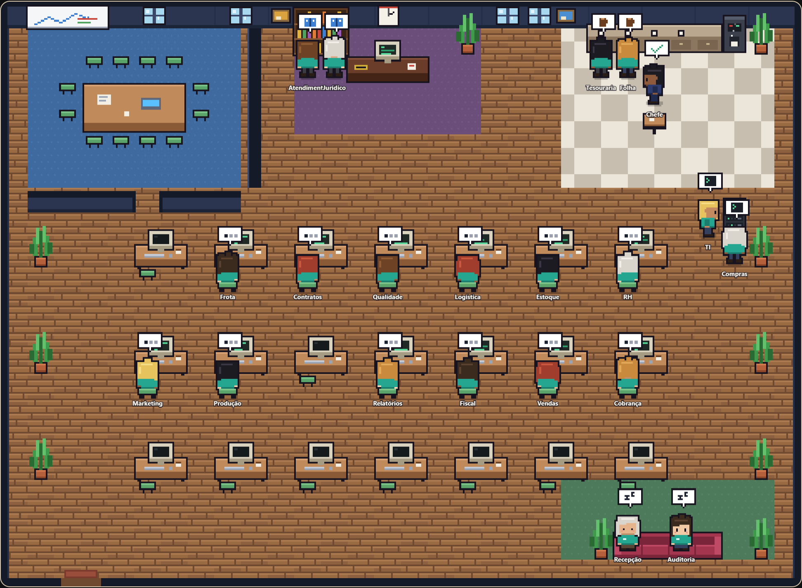
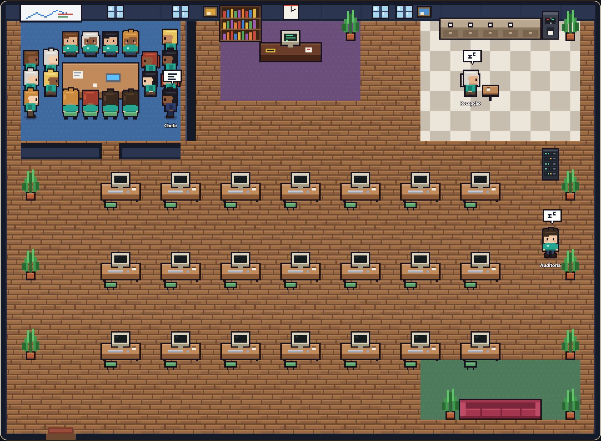
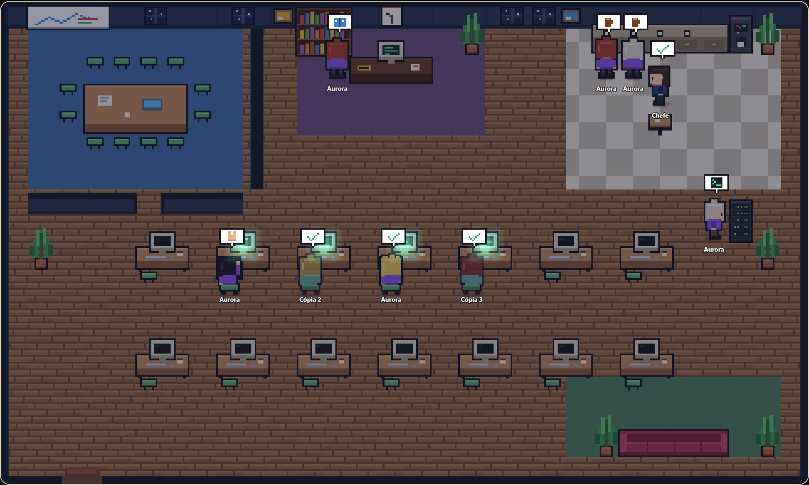
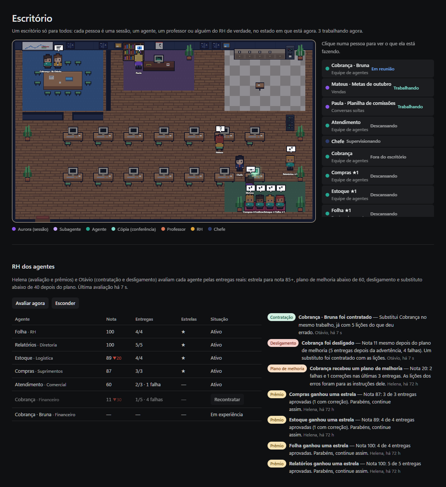
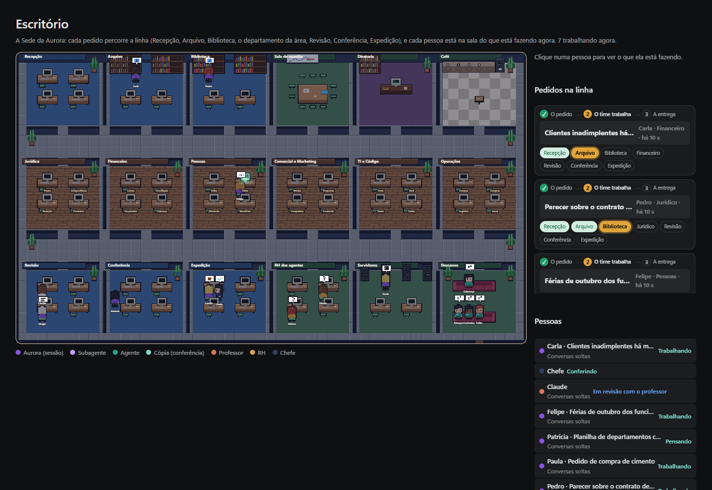

# Escritório dos agentes

A tela **Escritório**, na barra lateral, mostra o trabalho da Aurora como uma sala de escritório vista de cima, em pixel art. Ela transforma sessões, agentes e subagentes numa camada visual de observabilidade.

A arte é nossa, sem sprites de terceiros, e é desenhada pixel a pixel em `frontend/src/officePixel.ts`:
- sala de 480 × 288 px, com ladrilhos de 16 px, ampliada sem suavização;
- parede do fundo com prateleiras, janelas e um relógio com a hora real;
- piso de tábuas, tapetes e piso xadrez por área;
- paredes em volta da sala de reunião;
- pessoinhas com contorno escuro que andam nas quatro direções e se sentam de costas no computador, digitando.

O estilo é o do [Pixel Agents](https://github.com/pixel-agents-hq/pixel-agents).

## Fiel aos dados

Cada pessoa na sala é algo real do Harness, no estado em que está agora. Nada é encenado.

| Pessoa | O que representa | De onde vem |
| --- | --- | --- |
| **Sessão da Aurora** (roxo) | O turno de uma conversa trabalhando agora, ou que acabou de responder (uma por conversa). Cada sessão tem um nome próprio: começa com a mesma letra do título da conversa ("Metas de outubro" → Mariana), é escolhido pelo código da conversa (a mesma sessão mantém o nome) e não se repete na sala (`sessionName`). As cópias levam o nome de quem ajudam ("Cópia 2 de Paula"). Uma sala sem trabalho mostra a Aurora descansando. | `app/pendingTurns.js` (`turnSnapshots`) |
| **Agente** (verde-água) | Um agente de tarefa (Agentes), no estado da sua execução. | `app/agents.js` (agentes e `agent_runs`) |
| **Cópia** (verde claro, translúcida) | As cópias do modelo local conferindo uma resposta. | o estágio "Conferindo a resposta com N cópias" (`app/copies.js`) |
| **Subagente** (lilás, crachá da Aurora) | Uma parte de uma entrega que a Aurora dividiu (uma planilha, uma seção): trabalha ao lado dela e, entregue a parte, vai ao café. | `app/agentTools/subagents.js` (pendingTurns `setSubagent`) |
| **Professor** (laranja, crachá C ou X) | Claude ou Codex, **só enquanto revisa**: entra na sala, senta à mesa de reunião com quem é revisado e sai depois. | o estágio "Revisando com…" (`app/teachingLoop.js`) |
| **Chefe** (terno e gravata) | A orquestradora e a conferência de entrega. | `app/orchestrator.js` e as execuções |

## Salas

- **Equipe de agentes:** os agentes de tarefa trabalham juntos neste andar.
- **Projetos:** cada projeto tem a sua sala, com as conversas dele.
- **Conversas soltas:** as conversas sem projeto.

## Para onde cada estado leva

| Estado | Onde fica |
| --- | --- |
| Trabalhando: uma ferramenta rodando ("Pesquisando na web", "Escrevendo a entrega", "Lendo arquivos"…) | Na mesa, digitando; o monitor acende. |
| Pensando, chegando (carregando o modelo) | Na mesa. |
| Esperando sua autorização | Na mesa, com a mão levantada. |
| Em revisão com o professor | Na mesa de reunião, ao lado do professor. |
| Refazendo com as lições | Na mesa, com o chefe ao lado cobrando qualidade. |
| Reunião (pedido para a equipe) | Na mesa de reunião, com o chefe. |
| Acabou de entregar (10 min para agentes, 5 min para conversas) | No cafezinho; o chefe passa para conferir a entrega. |
| Não entregou, ou o professor pediu correção (30 min) | Na mesa, com um "!" e o chefe ao lado cobrando a entrega. |
| Sem trabalho | No sofá, e de vez em quando dá uma volta: café, janela, sofá. |
| Agente desligado | Fora da sala; aparece só na lista. |

Quem chega entra pela porta e anda até o seu lugar; quem sai do retrato anda até a porta.

### A sala cresce com a equipe

A sala ganha uma fileira de 7 computadores para cada 7 pessoas, com pelo menos 2 fileiras (14 computadores). O sofá e a porta descem junto, e a sala fica mais comprida.
- **Reunião:** tem 12 cadeiras e lugar para mais 14 de pé em volta da mesa. Numa reunião cheia fala um de cada vez, o chefe com mais frequência, e só aparece o nome de quem fala.
- **Estante e servidor:** quando estão ocupados, quem precisa deles trabalha no computador.
- **Sem lugar certo:** quem não tem um lugar específico fica de pé num ponto livre entre as fileiras. Ninguém sai da sala por falta de lugar.

### Vivo, sem inventar

O lugar e o gesto também seguem o que está acontecendo:
- **Ferramenta em uso:**
  - lendo arquivos ou buscando nos documentos: a pessoa vai à estante, com o sinal de livro;
  - rodando um comando: vai ao rack de servidores, com o sinal de terminal;
  - escrevendo, pesquisando na web ou montando o BI: digita no computador.

  O lugar de trabalho se mantém por pelo menos 5 s, para ninguém ficar correndo a cada passo curto.
- **Entrega:** leva o papel à mesa do chefe, pega um café na cafeteira e só então vai sentar no café.
- **Pensando há mais de 6 s:** levanta e anda ao lado da mesa, depois volta à cadeira.
- **Chefe sem nada para conferir:** faz ronda, parando um pouco atrás de cada um que trabalha.
- **Quem está livre:** dá voltas pelo sofá, pela janela e pelo café. Dois livres que se encontram param para conversar, com balões de fala em turnos.
- **Detalhes:**
  - os bonequinhos piscam e respiram;
  - os monitores mostram texto rolando;
  - a cafeteira solta vapor e o servidor pisca;
  - o relógio da parede marca a hora real;
  - as janelas mudam com a hora (dia, entardecer, noite com estrelas);
  - à noite a sala escurece e os monitores de quem trabalha brilham.

Clicar numa pessoa mostra:
- o que ela está fazendo e há quanto tempo;
- a tarefa e o andamento do plano;
- **Abrir conversa** (a conversa real daquela execução) ou **Ver agentes**.

## Arquivos

- `app/office.js`:
  - `buildOffice`: monta o retrato a partir dos fatos (função pura);
  - `officeSnapshot`: reúne os dados;
  - rota `GET /api/office`.
- `frontend/src/officeSim.ts`: a planta da sala, os lugares de cada estado, o caminho (A*) e o passo de cada quadro (sem React; testado em `frontend/test/office.test.mjs`).
- `frontend/src/officePixel.ts`: a pixel art (sala, móveis, pessoas, balões).
- `frontend/src/OfficeView.tsx`: monta a cena por profundidade, amplia sem suavização e escreve os nomes nítidos por cima; mostra a lista e o cartão. Lê o escritório a cada 1,5 s com a janela visível; com "menos movimento" ligado no sistema, as pessoas vão direto ao lugar.
- Testes:
  - `test/office.test.js`: estados e salas;
  - `test/office-ui.test.js`: a tela aberta num servidor de teste.

## Um escritório só, e o RH dos agentes (13/10)

Todos ficam na mesma sala: cada pessoa leva o projeto em que trabalha (na lista e no cartão), com um chefe para o andar inteiro.

O RH (`app/hr.js`) tem duas pessoas na sala: **Helena** (avaliação e prêmios) e **Otávio** (contratação e desligamento). A cada hora, ou no botão **Avaliar agora**, elas dão uma nota a cada agente de tarefa pelas últimas 10 entregas reais, com as recentes pesando mais:

| Entrega | Pontos |
| --- | --- |
| Entregue sem correção | 100 |
| Segurada várias vezes pelas travas | 80 |
| Corrigida pelo professor | 60 |
| Desfeita pela pessoa | 30 |
| Falhou | 0 |

Depois de 3 entregas:
- **Nota 85 ou mais:** uma estrela (no máximo uma por semana). A estrela aparece no nome, na sala.
- **Nota abaixo de 60:** plano de melhoria. Os problemas que o professor apontou e os erros das execuções viram regras nas instruções do agente, e as regras continuam lá quando o agente é editado.
- **Nota abaixo de 40, com pelo menos 5 entregas e 2 delas depois do plano:** desligamento. O agente é desligado, sem ser apagado, e um substituto ("Cobrança · Bruna") é contratado para o mesmo trabalho, com a mesma missão, pasta e gatilho, já com todas as lições. **Recontratar** desfaz.
- **Nota que sobe 15 pontos depois do plano:** um elogio.

Na sala, a Helena vai até quem ganhou estrela ou plano, e o Otávio recebe o contratado na sala de reunião.

## A Sede da Aurora: a linha de produção de entrega (13/10)

Um escritório só, com departamentos, como numa planta baixa (`app/headquarters.js`, `makeHQ` em `frontend/src/officeSim.ts`). A ideia veio de um escritório de advocacia de agentes, com salas de Leitura do processo, Provas, Prazos, Biblioteca, Redação, Revisão e Conferência de citações; aqui ela vale para qualquer área.

| Faixa | Salas |
| --- | --- |
| Entrada e apoio | Recepção, Arquivo, Biblioteca, Sala de reunião, Diretoria, Café |
| Departamentos | Jurídico, Financeiro, Pessoas, Comercial e Marketing, TI e Código, Operações (cada um com quatro mesas nomeadas, como Prazos ou Conciliação) |
| Qualidade e apoio | Revisão, Conferência, Expedição, RH dos agentes, Servidores, Descanso |

**Cada pedido é uma ficha** que percorre a linha: Recepção → Arquivo → Biblioteca → o departamento da área → Revisão → Conferência → Expedição. No painel ao lado, cada ficha mostra a etapa (① O pedido, ② O time trabalha, ③ A entrega) e as estações (feita, agora, pulada, falta).

**Nada é encenação.** A sala de cada pessoa vem do que ela está fazendo de verdade:

| O que ela faz | Onde fica |
| --- | --- |
| Entendendo o pedido, ou esperando autorização | Recepção |
| Lendo arquivos, a busca da empresa, as memórias, o `code_map` | Arquivo (estantes) |
| Pesquisando na web, documentação, `learn`, navegador | Biblioteca |
| Escrevendo a entrega | Departamento da área do pedido, que sai das palavras ("inadimplentes" vai para o Financeiro, "contrato" para o Jurídico, "site" para TI e Código) |
| Rodando comandos | Servidores |
| Com o professor, as cópias ou refazendo | Revisão |
| Uma trava acabou de disparar | Conferência, com o motivo ("faltava um arquivo do pedido", "disse que rodou sem rodar") |
| Acabou de entregar | Expedição; depois o Café ou o Descanso |

### Recepção, Expedição e Conferência de verdade

- **Recepção** (`app/serviceOrder.js`): antes de trabalhar, o pedido vira uma ordem de serviço. Ela traz o que entregar (arquivos, formato, pasta), as regras ("mais de 300 funcionários em cada linha"), se é para rodar e mostrar o resultado, e se a fonte precisa ser oficial. A ordem entra no prompt e aparece na ficha.
- **Regras por departamento** (`app/runtime-policy/areas/*.md`): um checklist curto da área, só em pedido daquela área. Por exemplo, no Jurídico: leis só de fonte oficial, prazo em dias úteis ou corridos com a data final.
- **Expedição:** antes de a resposta sair, a entrega é conferida contra a ordem. Volta uma vez se o formato pedido não foi gravado, se o que era para rodar não rodou ou se o texto escapou para outro alfabeto. Se a resposta não diz onde está o arquivo, o caminho é acrescentado.
- **Conferência de citações:** cada artigo, lei, súmula ou decreto citado na resposta ou nos documentos gravados precisa aparecer no que foi lido nesta resposta. Um "art. X da Lei N" só vale numa página que tenha a lei N. O que não aparece volta para ser confirmado (o `web_fetch` com `find="Art. N"` traz o artigo de uma lei longa); o que sobrar no fim sai com um aviso claro.
