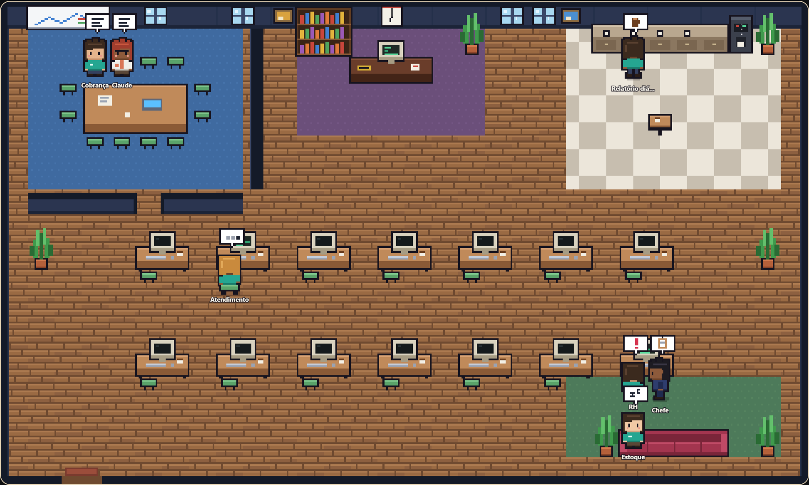
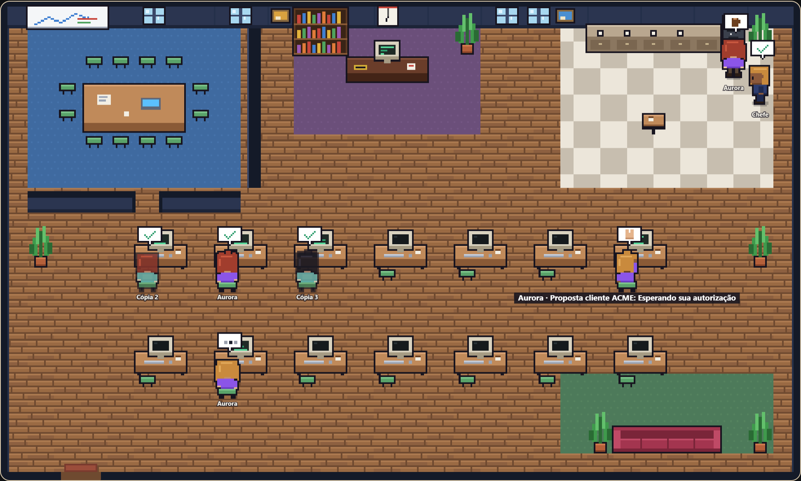

# Escritório dos agentes

A tela **Escritório**, na barra lateral, mostra o trabalho da Aurora como uma sala de escritório vista de cima, em pixel art. Ela transforma sessões, agentes e subagentes numa camada visual de observabilidade.

A arte é nossa, sem sprites de terceiros, e é desenhada pixel a pixel em `frontend/src/officePixel.ts`:
- sala de 480 × 288 px, com ladrilhos de 16 px, ampliada sem suavização;
- parede do fundo com prateleiras, janelas e um relógio com a hora real;
- piso de tábuas, tapetes e piso xadrez por área;
- paredes em volta da sala de reunião;
- pessoinhas com contorno escuro que andam nas quatro direções e se sentam de costas no computador, digitando.

O estilo é o do [Pixel Agents](https://github.com/pixel-agents-hq/pixel-agents).

## Fiel aos dados

Cada pessoa na sala é algo real do Harness, no estado em que está agora. Nada é encenado.

| Pessoa | O que representa | De onde vem |
| --- | --- | --- |
| **Aurora** (roxo) | O turno de uma conversa trabalhando agora, ou que acabou de responder (uma por conversa). Uma sala sem trabalho mostra a Aurora descansando. | `app/pendingTurns.js` (`turnSnapshots`) |
| **Agente** (verde-água) | Um agente de tarefa (Agentes), no estado da sua execução. | `app/agents.js` (agentes e `agent_runs`) |
| **Cópia** (verde claro, translúcida) | As cópias do modelo local conferindo uma resposta. | o estágio "Conferindo a resposta com N cópias" (`app/copies.js`) |
| **Professor** (laranja, crachá C ou X) | Claude ou Codex, **só enquanto revisa**: entra na sala, senta à mesa de reunião com quem é revisado e sai depois. | o estágio "Revisando com…" (`app/teachingLoop.js`) |
| **Chefe** (terno e gravata) | A orquestradora e a conferência de entrega. | `app/orchestrator.js` e as execuções |

## Salas

- **Equipe de agentes:** os agentes de tarefa trabalham juntos neste andar.
- **Projetos:** cada projeto tem a sua sala, com as conversas dele.
- **Conversas soltas:** as conversas sem projeto.

## Para onde cada estado leva

| Estado | Onde fica |
| --- | --- |
| Trabalhando: uma ferramenta rodando ("Pesquisando na web", "Escrevendo a entrega", "Lendo arquivos"…) | Na mesa, digitando; o monitor acende. |
| Pensando, chegando (carregando o modelo) | Na mesa. |
| Esperando sua autorização | Na mesa, com a mão levantada. |
| Em revisão com o professor | Na mesa de reunião, ao lado do professor. |
| Refazendo com as lições | Na mesa, com o chefe ao lado cobrando qualidade. |
| Reunião (pedido para a equipe) | Na mesa de reunião, com o chefe. |
| Acabou de entregar (10 min para agentes, 5 min para conversas) | No cafezinho; o chefe passa para conferir a entrega. |
| Não entregou, ou o professor pediu correção (30 min) | Na mesa, com um "!" e o chefe ao lado cobrando a entrega. |
| Sem trabalho | No sofá, e de vez em quando dá uma volta: café, janela, sofá. |
| Agente desligado | Fora da sala; aparece só na lista. |

Quem chega entra pela porta e anda até o seu lugar; quem sai do retrato anda até a porta.

Clicar numa pessoa mostra:
- o que ela está fazendo e há quanto tempo;
- a tarefa e o andamento do plano;
- **Abrir conversa** (a conversa real daquela execução) ou **Ver agentes**.

## Arquivos

- `app/office.js`:
  - `buildOffice`: monta o retrato a partir dos fatos (função pura);
  - `officeSnapshot`: reúne os dados;
  - rota `GET /api/office`.
- `frontend/src/officeSim.ts`: a planta da sala, os lugares de cada estado, o caminho (A*) e o passo de cada quadro (sem React; testado em `frontend/test/office.test.mjs`).
- `frontend/src/officePixel.ts`: a pixel art (sala, móveis, pessoas, balões).
- `frontend/src/OfficeView.tsx`: monta a cena por profundidade, amplia sem suavização e escreve os nomes nítidos por cima; mostra a lista e o cartão. Lê o escritório a cada 1,5 s com a janela visível; com "menos movimento" ligado no sistema, as pessoas vão direto ao lugar.
- Testes:
  - `test/office.test.js`: estados e salas;
  - `test/office-ui.test.js`: a tela aberta num servidor de teste.
